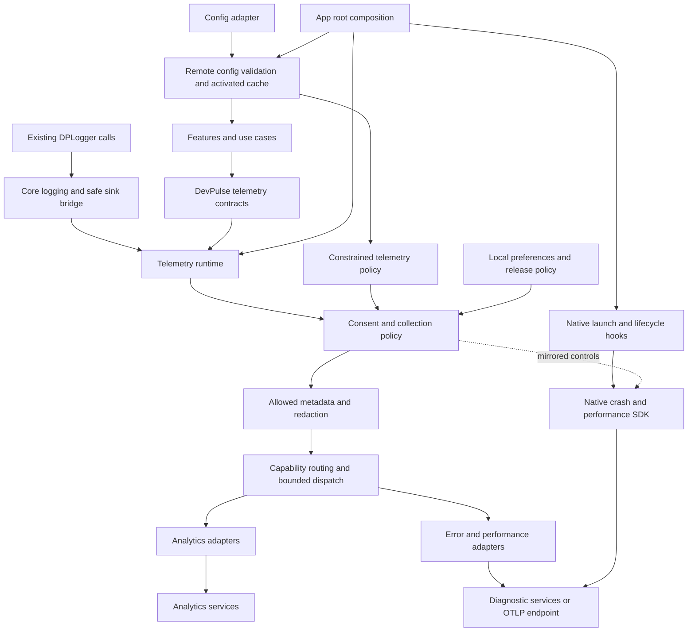
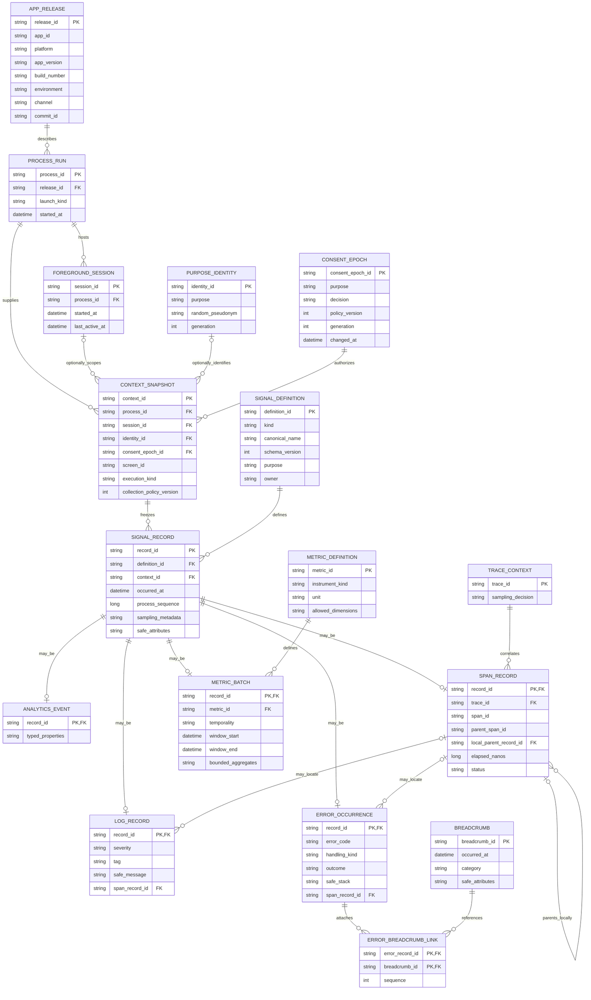
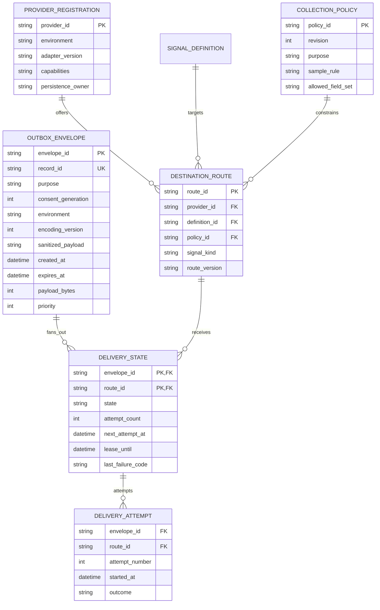
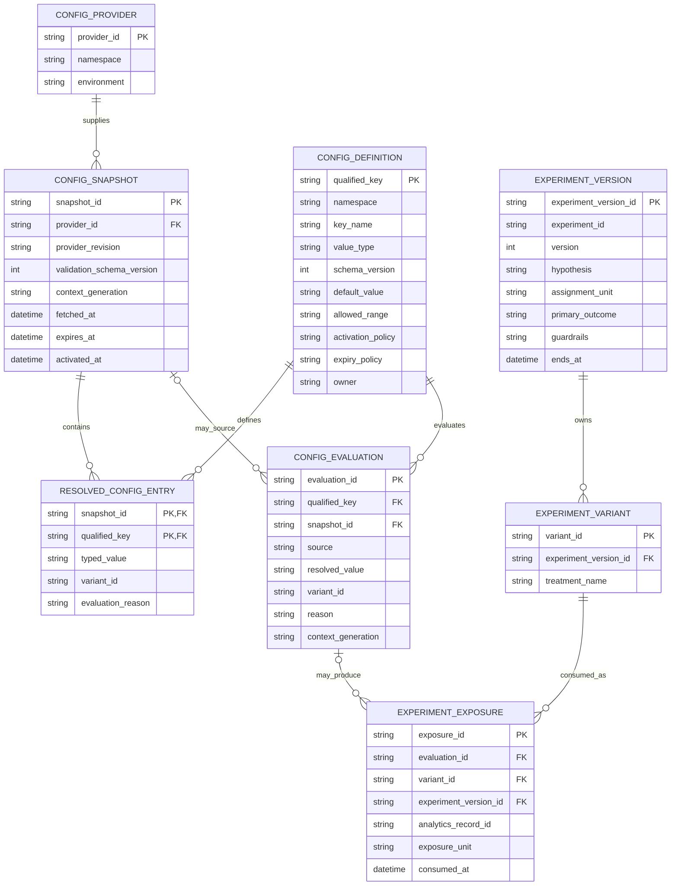

# Provider-independent observability and remote configuration for DevPulse

Design proposal, 18 October 2026. Source inspection ended at Git revision `09bf687`. This document proposes implementation work. No application code, provider accounts, remote settings, or database schemas were changed. No app builds or runtime experiments were run for this plan.

The document separates source findings from proposed behavior. Use these sections to navigate it.

- [1. Recommended design](#1-recommended-design)
- [2. What exists today](#2-what-exists-today)
- [3. Signals that belong together and signals that stay separate](#3-signals-that-belong-together-and-signals-that-stay-separate)
- [4. Component architecture](#4-component-architecture)
- [5. Provider-free contracts and typed data](#5-provider-free-contracts-and-typed-data)
- [6. Logical ERD for telemetry](#6-logical-erd-for-telemetry)
- [7. Runtime behavior and lifecycle](#7-runtime-behavior-and-lifecycle)
- [8. Delivery, offline behavior, and optional outbox ERD](#8-delivery-offline-behavior-and-optional-outbox-erd)
- [9. Remote configuration and experiment ERD](#9-remote-configuration-and-experiment-erd)
- [10. Event catalog and instrumentation ownership](#10-event-catalog-and-instrumentation-ownership)
- [11. Performance monitoring model](#11-performance-monitoring-model)
- [12. Privacy, retention, and collection controls](#12-privacy-retention-and-collection-controls)
- [13. Standards and useful tools](#13-standards-and-useful-tools)
- [14. Decision tree and alternatives](#14-decision-tree-and-alternatives)
- [15. Implementation sequence and verification](#15-implementation-sequence-and-verification)
- [16. Dashboards, alerts, and ongoing ownership](#16-dashboards-alerts-and-ongoing-ownership)
- [17. Open choices and evidence still needed](#17-open-choices-and-evidence-still-needed)

## 1. Recommended design

DevPulse owns the vocabulary and the tracking interfaces. Providers own transport, dashboards, native crash handling, and provider-specific instrumentation. Features record typed product events, handled errors, timings, and metrics through DevPulse interfaces. Existing logging calls continue through `DPLogger` and `DPLog`.

Use separate public contracts for analytics, errors, tracing, metrics, and remote configuration. Share release metadata, safe attribute types, local consent enforcement, provider lifecycle, and internal health reporting where their semantics match. Compose the selected implementations at the application root.

Remote configuration is a separate control system. It returns typed values to features and constrained collection policy to telemetry. It does not receive every telemetry event, grant consent, or choose arbitrary executable code.

Start with a small runtime, one recording test provider, and one real adapter per required capability. Preserve native SDK delivery where it meets the privacy and reliability requirements. Add an application-owned durable queue only when a concrete delivery requirement cannot be met by the selected SDK. The detailed delivery ERD below describes that extension without making it a prerequisite.

The intended promise is precise. After a tracking call exists, adding or replacing a provider changes adapters, dependencies, native integration, release tooling, and root registration. It does not change that tracking call. A provider cannot implement a capability that its platform SDK lacks. A remote flag cannot install an SDK that was never included in the app.

### The user experience

Telemetry consent and telemetry availability never gate app features. Existing local content remains usable offline. Fetching new feeds still needs network access. The app asks for no account or advertising identifier for observability. Product analytics and diagnostics have separate opt-ins, both initially off. Remote application logs, session replay, screenshots, view hierarchies, location, and profiling are initially off. Profiling remains a separate capability decision even after diagnostic consent.

Offer the controls in Settings with plain descriptions. Analytics helps understand which features people use. Diagnostics helps investigate crashes and slowness. Do not interrupt reading or make consent a condition of using the app. Avoid repeated prompts after a refusal. Provide a local diagnostic preview and an explicit, redacted support export later if useful. That export is a separate user action.

This recommendation follows the product goal of a clean, helpful, friendly app. The cost is fewer diagnostic samples and selection bias in usage data. Dashboards must describe their population as consenting installations or sessions. They must not treat that population as all users. These are product defaults, not a claim about legal requirements in every region.

### What success means

An implementation earns the provider-independent claim when these checks pass:

1. A fixture records a product event, handled error, correlated log, span, and metric through the same feature code with adapter A, adapter B, and no adapters.
2. Both adapters receive the same allowed business meaning. Unsupported capabilities are visible in a capability report.
3. A failed provider, full queue, offline device, unavailable config service, or denied consent cannot break the feature.
4. Changing a flag provider leaves feature evaluation calls unchanged and preserves safe offline defaults.
5. Native release crashes produce readable stacks on every supported host for which crash collection is advertised.
6. With both opt-ins off, network inspection finds no telemetry traffic, including SDK automatic collection and prior-process reports.

## 2. What exists today

The following findings are verified in current source. Historical startup notes were used to locate code, then checked against the moved current files.

| Finding | Current evidence | Design consequence |
| --- | --- | --- |
| Logging already hides its backend. | [DPLog.kt](/Users/shounakmulay/Documents/Work/kmp/DevPulse/core/logging/src/commonMain/kotlin/dev/shounakmulay/devpulse/core/logging/DPLog.kt:7) wraps Kermit. [LogSink.kt](/Users/shounakmulay/Documents/Work/kmp/DevPulse/core/logging/src/commonMain/kotlin/dev/shounakmulay/devpulse/core/logging/LogSink.kt:3) accepts filtered entries. | Keep existing calls and use this sink boundary. |
| Log entries are unstructured. | [LogEntry.kt](/Users/shounakmulay/Documents/Work/kmp/DevPulse/core/logging/src/commonMain/kotlin/dev/shounakmulay/devpulse/core/logging/LogEntry.kt:3) has level, tag, message, and throwable. | Add optional structured context through a deliberate API extension. Do not infer analytics from message strings. |
| Sinks execute synchronously without individual failure isolation. | [KermitLogSinkWriter.kt](/Users/shounakmulay/Documents/Work/kmp/DevPulse/core/logging/src/commonMain/kotlin/dev/shounakmulay/devpulse/core/logging/KermitLogSinkWriter.kt:15). | A remote sink must enqueue bounded work promptly. One sink failure must not escape or prevent delivery to another. |
| App logging is hardcoded to debug configuration. | [DevPulseLogging.kt](/Users/shounakmulay/Documents/Work/kmp/DevPulse/composeApp/src/commonMain/kotlin/dev/shounakmulay/devpulse/logging/DevPulseLogging.kt:13). | Add explicit host-supplied release policy before remote adapters. |
| HTTP logging uses `LogLevel.ALL`. Only Authorization and Cookie headers are sanitized. | [DevPulseHttpClient.kt](/Users/shounakmulay/Documents/Work/kmp/DevPulse/core/network/src/commonMain/kotlin/dev/shounakmulay/devpulse/core/network/DevPulseHttpClient.kt:29). | Do not forward current HTTP messages remotely. Disable production bodies and use safe HTTP instrumentation instead. |
| DB paging logs include filters and cursor values. | [LocalRssPostWithFeedMetadataPagingDataProvider.kt](/Users/shounakmulay/Documents/Work/kmp/DevPulse/core/data/db/src/commonMain/kotlin/dev/shounakmulay/devpulse/core/data/db/paging/LocalRssPostWithFeedMetadataPagingDataProvider.kt:47). | Search text, titles, and content IDs need exclusion. |
| Startup configures logging, starts Koin, then launches all async initializers. | [DevPulseStartup.kt](/Users/shounakmulay/Documents/Work/kmp/DevPulse/composeApp/src/commonMain/kotlin/dev/shounakmulay/devpulse/startup/DevPulseStartup.kt:21), [StartupAsyncInitialiser.kt](/Users/shounakmulay/Documents/Work/kmp/DevPulse/core/common/src/commonMain/kotlin/dev/shounakmulay/devpulse/core/common/startup/StartupAsyncInitialiser.kt:3). | Local telemetry policy must exist before this fan-out. Remote fetching must not block startup. |
| Navigation supports multiple visible panes and parameterized routes. | [NavDisplay.kt](/Users/shounakmulay/Documents/Work/kmp/DevPulse/core/navigation/src/commonMain/kotlin/dev/shounakmulay/devpulse/core/navigation/NavDisplay.kt:20), [ExpandableListDetailScene.kt](/Users/shounakmulay/Documents/Work/kmp/DevPulse/core/navigation/src/commonMain/kotlin/dev/shounakmulay/devpulse/core/navigation/scene/listDetail/ExpandableListDetailScene.kt:38), [Screen.kt](/Users/shounakmulay/Documents/Work/kmp/DevPulse/core/navigation/src/commonMain/kotlin/dev/shounakmulay/devpulse/core/navigation/Screen.kt:55). | Observe committed visible content. Do not count navigation attempts or serialize routes. |
| Preferences already have typed reads, observations, and batch writes. | [DevPulsePreferences.kt](/Users/shounakmulay/Documents/Work/kmp/DevPulse/core/data/preferences/src/commonMain/kotlin/dev/shounakmulay/devpulse/core/data/preferences/DevPulsePreferences.kt:6). | Reuse the settings persistence pattern for consent. |
| There is no identified analytics catalog, remote-config implementation, consent model, or tracing integration. | Scoped source and dependency searches covered application, core, feature, native entry points, version catalog, and settings. Generated and build directories were excluded. | Design these as new boundaries. This is a source-search result, not runtime certification. |

The current logger tests already cover lazy messages below the minimum level, throwable preservation, fan-out, filtering, and reconfiguration. Extend those behaviors rather than replacing the logger wholesale.

## 3. Signals that belong together and signals that stay separate

| Concern | Question it answers | Contract | Delivery character | Relationship to other concerns |
| --- | --- | --- | --- | --- |
| Product analytics | What meaningful actions and outcomes do consenting users experience? | `Analytics` | Typed events. Stable names and versions. | May include approved experiment exposure. Never derived from logs. |
| Diagnostic logs | What happened around an operation? | Existing `DPLogger`, optional structured logging API | Local first. Remote logs opt-in and allowlisted. | Selected safe entries can become breadcrumbs. |
| Handled errors | Which failures deserve investigation? | `ErrorReporter` | Explicit occurrences with stable error codes and context. | May refer to a span and safe breadcrumbs. |
| Fatal crashes and hangs | Why did the process terminate or stop responding? | Platform adapter lifecycle, common capability declaration | Native SDK handling and next-launch delivery. | Same release and privacy policy. Different capture mechanism. |
| Traces | Where did an operation spend time? | `Tracer` | Parent/child spans and asynchronous links. | Correlates logs and errors. |
| Metrics | How often, how much, and how slow? | `Metrics` | Counters, histograms, and bounded gauges. | Aggregation does not depend on trace sampling. |
| Remote configuration | Which approved value applies here? | `RemoteConfig` | Typed local evaluation against an activated snapshot. | Separate fetch/cache lifecycle. Can constrain telemetry. |
| Experiments | Which assigned treatment was actually consumed? | `ExperimentExposureRecorder` using analytics | Explicit exposure plus outcome events. | Assignment belongs with config. Exposure belongs with analytics consent. |
| User preferences | What did this person choose? | Existing settings use cases | Durable local state. | Remote config cannot silently override consent or preferences. |
| Operational and audit records | Who changed a remote policy, and what did the service do? | Provider or future server tooling | Server-side ownership. | Do not treat mobile analytics as an authoritative audit or billing ledger. |

Use one initialization owner for a vendor SDK that implements several contracts. Do not instantiate separate vendor clients for analytics and errors if the vendor expects a singleton. Separate interfaces do not require separate processes, queues, accounts, or Gradle modules for every signal.

## 4. Component architecture



The common runtime governs explicit telemetry calls. Native automatic collection is another collection path. Each adapter must apply equivalent consent, redaction, sampling, identity, and release controls to that path. A common facade alone cannot enforce them.

### Proposed modules and dependencies

| Module | Responsibility | Permitted dependencies |
| --- | --- | --- |
| Existing `:core:logging` | Local logging API, Kermit, sink forwarding, optional safe structured fields. | Existing foundations. No vendor observability SDK or product analytics catalog. |
| New `:core:telemetry:api` | `Analytics`, `ErrorReporter`, `Tracer`, `Metrics`, safe attributes, identifiers, provider SPI. | Minimal Kotlin libraries. No provider, network, Room, Compose, or DI requirement in public contracts. |
| New `:core:telemetry:runtime` | Consent gate, immutable context, routing, lifecycle state, bounded dispatch, health counters, logging bridge. | Telemetry API, logging, coroutines, small foundation types. Storage and clock ports where needed. |
| New `:core:remoteconfig` | Typed keys, evaluation metadata, snapshot validation, activation, storage/provider ports, defaults. | Minimal Kotlin, coroutines, serialization. No telemetry runtime dependency. |
| Selected adapter module, created when needed | One SDK integration, platform implementations, translation, capability declaration. | Telemetry API or remote-config contracts, selected SDK. Does not own business event names. |
| Existing settings domain/data modules | Purpose consent persistence and use cases. | Current project layering and preferences. Runtime consumes an injected consent port. |
| `:composeApp` and native hosts | App policy, provider registration, release metadata, platform hooks, SDK build integration. | Runtime, config, selected adapters, settings. |

Feature and domain modules depend on provider-free contracts only where they emit a signal. `core:network` depends on the telemetry API if it emits spans. The runtime must not depend back on the instrumented app HTTP client. Adapter upload transports bypass application instrumentation.

Keep `core:common` below these modules. Do not add telemetry to every module automatically through a convention plugin. That can introduce cycles and makes ownership harder to see. Register Gradle references through `Modules.kt` constants. Use the existing convention plugins after checking their automatic dependency behavior.

The exact module split is intentionally modest. Add a separate event-contract module only if several features need the same event definitions. A single analytics god-module that imports every feature would reverse dependencies.

## 5. Provider-free contracts and typed data

The following signatures describe the intended contract. They are design sketches, not compiled Kotlin. All types named here are proposed project-owned types.

```kotlin
interface Analytics {
	fun track(event: AnalyticsEvent)
}

interface ErrorReporter {
	fun capture(error: Throwable, context: ErrorContext)
	fun capture(failure: DiagnosticFailure)
	fun breadcrumb(breadcrumb: SafeBreadcrumb)
}

interface Tracer {
	suspend fun <T> trace(
		operation: OperationDefinition,
		attributes: SafeAttributes,
		block: suspend TraceScope.() -> T,
	): T
}

interface Metrics {
	fun increment(metric: CounterDefinition, attributes: MetricAttributes)
	fun record(metric: HistogramDefinition, value: Double, attributes: MetricAttributes)
}

interface RemoteConfig {
	fun <T : ConfigValue> evaluate(key: ConfigKey<T>): ConfigEvaluation<T>
	fun <T : ConfigValue> observe(key: ConfigKey<T>): Flow<ConfigEvaluation<T>>
	suspend fun refresh(): Result<ConfigRefreshResult>
}

interface TelemetryLifecycle {
	suspend fun flush(deadline: Duration): FlushReport
	suspend fun close(deadline: Duration): CloseReport
}
```

`track`, `capture`, and metric recording return promptly and never throw because a provider failed. They promise best-effort admission, not successful upload. Operational status is available through a separate inspector and local counters. Config refresh returns a `Result`. Instrumented business calls preserve their original return value, failure, and cancellation.

`AnalyticsEvent` is an interface with a stable `EventDefinition` and explicit typed properties. Feature-owned data classes implement it. The shared API does not need a sealed subclass for every feature. Each definition declares name, schema version, purpose, allowed fields, owner, and deprecation policy. A catalog test registers all definitions and catches duplicate names or incompatible versions.

`SafeAttributes` uses a closed `AttributeValue` hierarchy for text, boolean, integer, and decimal values. It has no `Any`, arbitrary object serialization, or provider bundle type. Attribute definitions carry maximum length, cardinality class, and privacy policy. Product event constructors use feature enums and typed values. An adapter receives validated canonical records.

`OperationDefinition`, `CounterDefinition`, and `HistogramDefinition` carry fixed names and units. `MetricAttributes` permits only bounded dimensions. Feed URLs, IDs, trace IDs, timestamps, search strings, and error messages cannot become metric labels. Counts and durations have defined units, including milliseconds or bytes.

The logger may retain text for local development. Remote structured entries require a catalogued safe message or approved fields. Regex redaction is a secondary guard. It cannot reliably recover privacy after arbitrary body content has already entered a queue.

### The provider integration contract

Each adapter supplies a `ProviderDescriptor` and implements a separate internal provider SPI for its capabilities. Application contracts such as `Analytics` and `ErrorReporter` are implemented by the runtime, not bound directly to vendor adapters. The descriptor includes provider ID, supported host targets, SDK/version metadata, capability flags, delivery ownership, and collection-control behavior.

The provider SPI receives frozen, sanitized, purpose-bound records after runtime admission. Proposed `AnalyticsSink`, `HandledErrorSink`, `LogRecordSink`, and `MetricBatchSink` accept their corresponding canonical payloads. Handoff returns a closed outcome such as `AcceptedBySdk`, `AcknowledgedByServer`, `RetryableFailure`, `PermanentFailure`, or `RejectedByPolicy`. Adapters translate SDK exceptions into these outcomes. A synchronous SDK call with no delivery acknowledgment reports only `AcceptedBySdk`.

Tracing has a separate `SpanSink` contract for admitted start, safe updates, and end records. Its adapter-local handle maps a canonical trace/span ID to a vendor span. The handle never reaches feature code. Start/end share frozen purpose, consent generation, and parent context. A disabled or unsampled span uses a no-op handle and preserves the block's result. Flush, purge, identity reset, and automatic-collection controls belong to the internal provider lifecycle SPI. This split prevents an adapter from bypassing consent or reading mutable screen/user context later.

The runtime builds routes from explicit app registrations. Koin resolves concrete or qualified definitions and gathers them with `getAll<ProviderContract>()`. Do not depend on registration order or ambiguous unqualified single-provider resolution. Reject duplicate provider IDs. Use explicit startup dependencies where an adapter requires them.

| Capability to declare | Why it matters |
| --- | --- |
| Typed analytics and identity reset | Needed for consent changes and logout. |
| Explicit handled errors and safe breadcrumbs | Independent of fatal capture support. |
| Native fatal, ANR, and hang capture, separately | These differ by host and SDK. |
| Manual spans and parent context | A flat timer cannot honestly claim full trace support. |
| Counters, histograms, and aggregation semantics | Do not turn metrics into arbitrary analytics events silently. |
| Native startup, network, and frame instrumentation | Prevents conflicting automatic collectors. |
| On-device filtering before persistence and before upload | Required for privacy enforcement on automatic paths. |
| Disable, purge, reset, and bounded flush behavior | Needed to implement withdrawal and shutdown promises. |
| SDK-owned offline persistence and retry | Determines whether an application outbox is needed. |
| Release artifacts and symbol support | Crash capture without readable stacks is insufficient. |

No adapter means a no-op implementation, safe defaults, and a visible local capability report. An unsupported optional capability remains unavailable. A required production capability fails release validation. Never silently claim native crash coverage because common `capture(Throwable)` works.

One provider failure does not trigger an automatic switch to a different analytics backend. That changes data recipients and identity semantics. Controlled migration can fan out to two approved destinations temporarily. Each destination gets independent admission and failure handling.

## 6. Logical ERD for telemetry

These are logical entities, not a request to create all these tables in Room. Most exist as code definitions, immutable in-memory records, SDK state, or provider-side data. Physical storage is described separately.



### Entity invariants

| Entity or relationship | Required invariant | Physical representation |
| --- | --- | --- |
| Release and process | Release identity includes host build number and environment. Process IDs do not identify a person. | Immutable host-supplied context. |
| Foreground session | Optional for workers. Proposed session boundary is 30 minutes of inactivity, using monotonic time within a process. A new process starts a new session. | In memory initially. No fictional screen sessions for background jobs. |
| Purpose identity | Separate random pseudonyms for analytics and diagnostics. No device fingerprint, advertising ID, or raw account identity. Rotate on withdrawal/reset. | Local preferences when that purpose is granted. No stable cross-purpose join by default. |
| Consent epoch | One purpose and generation per decision. Unknown is denied for remote collection. Epochs allow pending work to be invalidated. | Current state in preferences. Historical rows are conceptual, not a required consent-history database. |
| Context snapshot | Captures permitted context at occurrence time. Identity/session foreign keys are nullable. Consent purpose matches the signal purpose. | Immutable record copied before asynchronous dispatch. |
| Signal record | Exactly one payload subtype. IDs identify occurrences, not error groups. Occurrence time and queue time are distinct. | In memory or the delivery owner's queue. |
| Definition | Unique kind, canonical name, and schema version. Rename or semantic change requires catalog review. | Code catalog and CI fixtures. |
| Trace context | One trace ID with unique span IDs. Local parent linkage is optional. A parent can be remote, unsampled, or already discarded. | Coroutine context and SDK span mapping. Not a mandatory relational FK to an existing span. |
| Metric batch | Metrics use aggregate windows and explicit temporality. Raw observations do not each become persisted signal rows. | SDK/runtime aggregation, then export. |
| Breadcrumb | Bounded safe diagnostic context. Never attach product-only attributes to errors without separate authorization. | Memory ring or SDK ring. |
| Error group | Provider grouping is derived from occurrences. Do not hardcode the provider issue ID as the application's error identity. | Provider side. Optional local stable error code/fingerprint hint. |

Every exported signal includes only the context needed for its purpose. Do not send the full context object to every provider. A product event does not need a device model or a stack trace. Default analytics records omit diagnostic trace/session join keys. An explicit future cross-purpose correlation policy would require review and both purposes to be permitted.

Fatal reports use this model for semantic mapping, but the native SDK may own their files and identifiers. Do not serialize a live `Throwable` into application persistence. Explicit error capture first creates a safe exception snapshot with type, scrubbed messages, original stack frames, and bounded causes. Portable sinks receive that snapshot. A compatible native error bridge may use the transient original throwable only when its tested event-construction hooks apply the same filtering before persistence and export. That bridge cannot resnapshot identity or bypass purpose admission. Reject an integration that can only obtain useful stacks by persisting prohibited data.

## 7. Runtime behavior and lifecycle

### Startup ordering

1. The native host records an early monotonic launch mark and supplies `AppReleaseContext`. Configure safe local logging before shared work.
2. Disable SDK automatic collection in manifest, plist, or equivalent build configuration where needed. Start with remote collection denied until persisted decisions are known.
3. Install the minimum native crash bootstrap only if it can honor the cached purpose state safely. If the host cannot read that state before initialization, defer collection. Accept missing very early crashes rather than collecting against an unknown decision.
4. Start Koin with platform context and root modules. Provider-specific pre-DI hooks may run here if the SDK requires them, with collection still gated. They must not resolve unavailable shared definitions.
5. After `startKoin` returns, create the runtime with compiled policy, no-op defaults, and immutable release context. Do this before launching `StartupAsyncInitialiser` instances. Instrument the initializer boundary without changing its business result.
6. Load consent and cached config asynchronously. Apply consent through the coordinator. Never block first render on network or use `runBlocking` to fetch remote policy.
7. Initialize or enable approved provider capabilities. Fetch fresh config and export permitted pending work in background tasks with independent failure boundaries.

The existing `DevPulseStartup.initialize` launches async initializers without readiness dependencies. Telemetry cannot be another unordered initializer if it must observe the others. A small synchronous coordinator setup solves ordering. It does not require a general application startup framework.

Android background cold starts follow the same policy even without a Compose window. Preserve `androidContext` before WorkManager configuration. iOS preserves HTML converter registration before current shared startup. Desktop initializes before window creation and owns bounded shutdown flush.

A provider can require registration inside `startKoin`, rather than afterward. Kotzilla is one documented example. Such setup belongs in a provider-specific root hook. If that hook cannot prevent prohibited automatic collection, the adapter does not meet this design's privacy contract. [Kotzilla KMP setup](https://doc.kotzilla.io/docs/getstartedCustom/setupKMP).

### Runtime and adapter state

Use an explicit process state machine with `Uninitialized`, `LocalReady`, `PolicyLoading`, `Ready`, and `Closing`. `Ready` means policy has loaded, not that every provider is healthy. Each adapter has independent `Disabled`, `Starting`, `Ready`, `Degraded`, and `Closed` states.

Before policy loads, local safe logs work and remote signals are dropped. Do not buffer pre-consent usage for later upload. After a grant, new records are eligible. Existing denied-period records stay absent.

Provider initialization has a timeout and limited retries. A `SupervisorJob` isolates adapters. Catch provider failures at adapter boundaries, rethrow `CancellationException`, and report internal faults through local counters. Never send exporter failures back through the same exporter recursively.

Repeated initialization must not create a second Koin context, register duplicate lifecycle observers, reset an active SDK, or install another crash handler. Close is idempotent. Application behavior remains independent of flushing success.

### Consent withdrawal and identity changes

1. Serialize the change through a consent coordinator and close new admission for the affected purpose immediately.
2. Advance the in-memory generation and persist the new decision with the settings batch-write path. Confirm a saved off state only after persistence succeeds. If persistence fails, remain disabled in this process and state that collection is paused for this run, the choice was not saved, and the prior saved choice may apply after restart. Retry the write and expose a save-failure state rather than displaying a durable off toggle. Startup always begins closed until state is loaded. The restart test must cover a failed revocation write and the previous durable grant. A future durable revocation latch can strengthen this guarantee, but it has its own storage-failure boundary and is not a substitute for honest UI.
3. Cancel queued work where possible. Reject records with an old generation immediately before handing them to a provider.
4. Disable the provider's automatic collection and purge its pending reports, breadcrumbs, attachments, and application outbox entries for that purpose. Use only adapters with a verified way to meet the promised behavior. A provider that cannot isolate purposes must use separate clients or disable the combined client.
5. Clear provider identity and reset the affected pseudonym. Re-granting begins a new generation and does not resurrect old data.

Already transmitted data and a request already in flight cannot be recalled by a local toggle. Explain this plainly in the privacy description. Server-side deletion, if offered, is a separate workflow with provider support and an acknowledgment. Do not promise remote erasure from a local queue purge.

The runtime's dispatcher and withdrawal operation share a dispatch barrier. A stale task cannot enter an SDK after withdrawal completes. SDK-internal scheduling and automatic uploads require separate native controls and verification. Process death between settings persistence and SDK cleanup must still restart closed and purge before re-enabling collection.

If accounts are added later, introduce an explicit account identity transition. Do not alias an anonymous history to an account automatically. Logout clears provider account identity and pending account-scoped context. Capture-time snapshots prevent old events being relabeled with the next signed-in user.

## 8. Delivery, offline behavior, and optional outbox ERD

### Default ownership

| Path | First implementation | Loss and retry semantics |
| --- | --- | --- |
| Local logs | Platform writer with safe release level. | Best effort. No universal durable log archive. |
| Safe breadcrumbs | Bounded in-memory ring or selected SDK ring. | Older entries drop when full. |
| Product events | Bounded dispatch to SDK-owned delivery when available. | SDK guarantees documented per adapter. No claim of exactly-once. |
| Handled errors | Compatible crash/error SDK. | SDK owns offline files and retry. Verify purge and TTL controls. |
| Fatal crashes | One primary native crash reporter per host. | SDK-specific crash-safe persistence and next-launch delivery. Common coroutine queues cannot replace this. |
| Spans and metrics | SDK batching or bounded exporter. | Sampling, aggregation, and bounded loss. No promise to reconstruct discarded spans. |
| Custom HTTP exporter | Optional outbox if offline survival is required. | At-least-once attempts within TTL. Duplicates remain possible. |

Choose one persistence/retry owner for each destination. If the SDK durably accepts an event, the application considers its handoff complete. Do not retry it through a second application queue because the eventual server acknowledgment is invisible. `AcceptedBySdk` and `AcknowledgedByServer` are different states.

Each provider gets its own worker and bounded queue. A blocked destination cannot delay another. Apply a maximum entry size, total bytes, count, and TTL. Drop expired entries first. Then apply class-specific shedding, such as low-priority remote logs before high-value error occurrences. Native crash files remain governed by the SDK's limits.

Use exponential backoff with jitter, server retry hints, and a maximum retry window. Treat network errors and retryable server failures separately from invalid payloads or unauthorized destinations. A permanent failure drops or disables the affected route with a local reason counter. Do not run endless fast retries on bad credentials.

Delivery is not globally ordered across providers. An installation-local process sequence can aid debugging. Device clocks can be wrong. Use wall time for occurrence timestamps and monotonic clocks for durations and in-process expiry calculations. Persist enough wall-time metadata for restart TTL checks and handle clock jumps conservatively.

### Optional application-owned storage



`PROVIDER_REGISTRATION`, routes, definitions, and policy can remain in code. Only `OUTBOX_ENVELOPE` and `DELIVERY_STATE` need durable tables when the custom-exporter branch is selected. `DELIVERY_ATTEMPT` is a bounded optional diagnostic view, not an unlimited audit table. Its logical key is envelope, route, and attempt number.

Use one transaction to create an envelope and its destination rows. Lease eligible destination rows before work, recover expired leases after a crash, and delete the envelope after every destination is terminal. Acknowledging one destination must not acknowledge another. Enforce uniqueness on envelope and route. Index state/next-attempt time and expiry. Re-check consent generation before every attempt.

Idempotency uses the same canonical record ID for retries. Backends may ignore that key, so duplicates must remain an accepted delivery risk. Neither a mobile outbox nor analytics is a financial ledger. Provider-native crash files never enter this outbox.

A route change must not send old data to a newly selected provider by accident. Each route version has an immutable unique `route_id`. Its provider registration also fixes environment and destination identity. A recipient, endpoint, environment, or route-version change creates a new registration/route identity instead of updating the target referenced by pending work. Pending records keep their original destination and route version. Migration explicitly drains, expires, or discards the old destination. Payload schema upgrades preserve readable old envelopes or purge them under the declared retention policy.

Store queue data separately from the user's feed database so telemetry cleanup cannot affect saved content. Use app-private storage and platform protection. Evaluate encryption at rest and backup exclusion against actual contents and host capabilities. Never store telemetry secrets or unredacted bodies in this database. Add migrations and corruption recovery only if this storage branch is implemented.

### Proposed initial resource limits

These numbers are design targets, not measurements. Reassess them with the chosen SDK on release artifacts.

| Resource | Initial target | Over-limit behavior |
| --- | --- | --- |
| Common dispatch memory | 256 records and 512 KiB, whichever is reached first. | Bounded drop with a local reason counter. |
| Breadcrumb memory | 50 safe entries, each at most 1 KiB. | Evict oldest. |
| Explicit record payload | 16 KiB after safe serialization. | Reject or truncate approved optional text. Never truncate an identifier into a collision. |
| Optional outbox | 5 MiB and 5,000 envelopes, with purpose-specific TTL. | Expire, then shed by declared priority. |
| Custom-exporter retries | At most 24 hours for analytics and 72 hours for handled errors. | Drop expired work. Adapt to provider acceptance windows. |
| Remote diagnostic logs | Disabled initially. Later use a short support window and a byte cap. | Stop remote logging at the cap or expiry. |
| Shutdown flush | At most 2 seconds when the host grants execution time. | Return incomplete. Never block exit indefinitely. |

SDK disk caches have separate limits. An adapter that cannot meet the selected resource or retention policy must disclose the gap before selection.

## 9. Remote configuration and experiment ERD

Remote config has one active authority per namespace. Use deterministic ownership if several namespaces have different providers. Do not race providers and take whichever value arrives first.

Definitions are app-owned and typed. Proposed `ConfigKey<T>` includes key name, codec, compiled default, allowed range or enum, owner, expiry policy, activation policy, and whether a rollout or experiment uses it. Remote payloads cannot introduce executable behavior or redefine the type.



`qualified_key` uniquely identifies namespace and key together. Entries and evaluations reference that same identity, and snapshots are restricted to the matching provider namespace/environment. Experiment ID plus version is unique. Each version has an immutable `experiment_version_id`. Variant IDs belong to exactly one version, and exposure references must agree with that version. Never update a historical variant or exposure to point at a new experiment version.

Evaluations normally exist as return values, not database rows or analytics events. Exposures become analytics only when the assigned treatment actually affects visible UI or executed behavior and analytics consent permits it. A config getter, prefetch, recomposition, or unused branch does not count as exposure.

Snapshot and definition rows correspond to a small validated cache plus code definitions. Experiment metadata and assignments normally remain provider-side. Do not build a custom experimentation platform as part of observability.

### Value precedence and activation

Resolve values in this order:

1. Compiled safe default.
2. Validated, unexpired activated cache for the same environment, namespace, schema compatibility, and targeting context.
3. Validated fresh provider result after its activation boundary.
4. Explicit developer override in a debug-only tool, followed by the same safety constraints.

Compiled invariants and user preferences constrain the result at every step. Consent is an independent gate, not another remote value. Remote policy can disable collection or lower collection volume. It cannot expand allowed fields, grant permission, raise volume beyond compiled ceilings, change release identity, or choose an arbitrary endpoint.

Validation is per typed key unless related keys declare an atomic consistency group. Reject an invalid group together. Unknown keys are ignored and reported locally. Oversized snapshots, invalid types, out-of-range values, malformed structures, and mismatched environment/context are rejected before activation. Keep last-known-good values where their expiry policy allows.

Separate fetch from activation. A visual layout flag applies at the next screen entry or session boundary. A configuration that changes a long-running sync applies to the next operation. An emergency disable can apply immediately to new work. UI observes the activated snapshot through `Flow`, rather than making a network request during rendering. [Firebase loading strategies](https://firebase.google.com/docs/remote-config/loading).

Store the active snapshot atomically. Keep one previous valid snapshot only if local rollback is needed. Treat provider revisions as opaque strings, not comparable integers. An intentional server rollback can publish a new snapshot with older feature values. Cache arrival ordering uses the current fetch generation and targeting context, so a slow old request cannot overwrite a newer context.

### Failure and security branches

| Situation | Required behavior |
| --- | --- |
| No provider configured | Compiled defaults work. Capability inspector says local-only. |
| First launch offline | Defaults immediately. No blocked splash screen. |
| Cached config is valid | Use it and refresh asynchronously. |
| Cache is expired | Apply each key's stale policy. Safety-sensitive disable keys fall back to their compiled safe behavior. Cosmetic keys may allow bounded stale use. |
| Fetch fails or service throttles | Keep valid active values, back off, and record local health. |
| Context or account changes during fetch | Discard the old result. New context gets its own cache namespace/generation. |
| Update requires restart | Stage it and expose pending activation in local diagnostics. |
| A kill switch is changed while offline | It takes effect only after a successful fetch. No remote system can guarantee immediate control of an offline app. |
| Production has a wrong or compromised value | Compiled safety limits still apply. Provider audit/rollback and environment isolation support recovery. |
| Flag controls access or entitlement | Client flag is presentation only. Server authorization remains authoritative. |
| Config contains secrets | Reject that design. Shipped defaults and fetched values are inspectable by the user. |
| Provider requires analytics for targeting | Avoid that dependency for essential flags. Use app/platform/version context or a provider-independent minimal fetch path. |

Start with version, platform, channel, and optional broad locale as evaluation context. A unique analytics identifier is unnecessary for global rollout controls. If per-installation stable assignment becomes useful, define its local purpose and retention explicitly. Do not quietly reuse diagnostic identity.

Use TLS and fixed app-approved destinations. A future self-hosted signed config format needs canonical encoding, signature validation, key rotation, replay/expiry rules, and a rollback mechanism. Do not add cryptography merely to duplicate a selected trusted provider SDK. These are separate operational choices. Client config is never a secret store. [Firebase Remote Config policies](https://firebase.google.com/docs/remote-config).

### Experiment discipline

Choose an assignment unit deliberately, such as a consenting installation or signed-in account. Keep it stable for the experiment version. Record experiment ID/version, variant, and actual exposure under the analytics purpose. Deduplicate at the declared exposure unit, typically first consumption per session and experiment version. Preserve assignment and outcome timestamps.

Do not move a participant between variants because an app process restarts. Snapshot config at the experiment's activation boundary. Provider migration requires an explicit assignment migration or a new experiment version. Do not combine contaminated cohorts silently.

Each experiment has an owner, end date, hypothesis, primary outcome, and safety guardrails. Compare exposure counts and assignment ratios before interpreting outcomes. Consent selection bias and missing uploads limit conclusions. Initial rollout flags do not need a statistical experiment system. Implement exposure reporting only when an actual experiment needs it.

## 10. Event catalog and instrumentation ownership

Track semantic actions deliberately. A low-level repository cannot infer whether a write was a user action, import, retry, or background recovery. The owner that knows the trigger emits the product event once. Technical layers emit their own spans, metrics, and errors without duplicating product outcomes.

| Proposed event | Owner and exact trigger | Allowed properties | Excluded content |
| --- | --- | --- | --- |
| `screen_viewed`, version 1 | App visibility observer after a foreground scene becomes committed and visible. | Stable screen ID, pane role, entry reason. | Route object, post/feed ID, URL. |
| `feed_add_started`, version 1 | Add-feed feature accepts the user's submit action. | Source such as manual or discovery. | URL, typed text. |
| `feed_add_completed`, version 1 | The same operation owner receives the final successful result. | Source, bounded result class. | Feed name and address. |
| `feed_add_failed`, version 1 | The owner surfaces a terminal failure to the user. | Stable failure code, retry availability. | Exception message and stack. |
| `feed_search_used`, version 1 | Browse/search feature executes an eligible user search. | Search surface, bounded query-length bucket, result-count bucket. | Query text, result IDs. |
| `post_opened`, version 1 | Reader feature commits to opening a post. | Entry surface, in-app/external mode. | Post title, URL, content ID. |
| `bookmark_changed`, version 1 | The operation commits the desired state. | Desired state and entry surface. | Post identity. |
| `setting_changed`, version 1 | A permitted non-sensitive setting is persisted. | Allowlisted setting key and enum/boolean value. | Arbitrary preference values. Consent controls are enforced locally. |
| `experiment_exposed`, version 1 | A versioned assigned treatment is consumed. | Approved experiment/version/variant. | Targeting attributes and raw user identity. |

This is a proposed starter catalog, not a statement that tracking currently exists. Add an event only when a concrete product question needs it. For example, feed-add conversion uses starts and terminal outcomes, not every parser attempt. Avoid per-keystroke, per-post sync, and per-recomposition analytics.

Canonical names use lowercase snake case. Keep an internal schema version separate from the provider event name. An additive optional field can preserve the existing meaning. Changed semantics require a new version and a migration policy. Adapter contract tests reject reserved names, unsupported types, oversized fields, and mapping collisions. Provider limits differ, so translate explicitly rather than relying on accidental acceptance. [Google event naming and collection guidance](https://developers.google.com/analytics/devguides/collection/protocol/ga4/reference/events).

### Instrumentation by code boundary

| Existing boundary | Proposed instrumentation | Ownership rule |
| --- | --- | --- |
| `composeApp/.../startup/DevPulseStartup.kt` | `app.shared_initialize`, initializer duration and outcome. | Host launch mark begins earlier. Shared setup timing is not full cold startup. |
| `composeApp/.../composables/DevPulseNavDisplay.kt` and core navigation visibility callback | Actual foreground screen and pane exposure. | App maps routes to safe IDs. Navigation does not import product event classes. |
| `core/ui/.../viewmodel/MviViewModel.kt` | No automatic product event serialization. | Features track meaningful events explicitly. Exception handling needs Orbit behavior verification before changing the base class. |
| `core/network/.../di/NetworkModule.kt` and `DevPulseHttpClient.kt` | One HTTP span per selected exchange/attempt model, duration, result class, byte counts. | One auto/manual network instrumentation owner per engine. Export requests are excluded. |
| `core/domain/feed/.../queue/RssFeedQueueExecutorImpl.kt` | Queue wait, drain, entry processing, batch persistence, and terminal outcome. | Operation context crosses queue boundaries explicitly. No unbounded per-item span tree. |
| `core/data/feed/.../repository/FeedImportFallbackParser.kt` | Attempt spans, fallback-used count, terminal parse outcome. | Recovered first-parser errors do not each become captured incidents. |
| `core/data/db/.../paging/LocalRssPostWithFeedMetadataPagingDataProvider.kt` | Initial/append/prepend/refresh query duration and row count. | No SQL parameters, titles, search strings, or cursor contents. |
| `feature/feed/.../sync/FeedSyncWorker.kt` | Execution span, skip/retry/failure/cancel outcome. | Span covers actual awaited work. Verify the current worker/executor completion contract rather than timing enqueue only. |
| Existing settings state/events/UI | Separate analytics and diagnostics controls. | Reuse DP components and established settings use cases. |

### Screen exposure details

Use stable IDs such as `feed_list`, `post_list`, `post_detail`, and `settings`. Keep navigation-instance identity local for deduplication. Two different posts can produce two `post_detail` exposures without sending either post ID. A recomposition produces none.

The observer considers foreground state, committed scene entries, and visible pane roles. Adaptive list/detail can expose both panes. A navigation attempt that is rejected, a restored hidden tab, or canceled predictive back does not emit a new screen view. A compact/expanded transition updates pane exposure according to a documented rule, rather than pretending a tap occurred.

### Error classification and duplicate prevention

| Outcome | Recommended diagnostic treatment |
| --- | --- |
| Expected validation or user cancellation | Optional safe log or bounded outcome metric. No defect capture. |
| Temporary network failure recovered by retry | Retry metrics and trace events. Sampled safe breadcrumb if useful. |
| Primary parser fails and fallback succeeds | Recovered outcome plus fallback metric. No default error incident. |
| All parsers fail and the user operation fails | One explicit handled occurrence at the terminal owner, with a stable code and original cause. |
| Unexpected invariant violation | Captured occurrence, safe stack, release and operation context. |
| Fatal native crash | Native reporter owns capture. Do not capture and then rethrow the same fatal failure through another reporter. |
| Coroutine cancellation | Preserve cancellation. Mark a canceled span. Do not classify it as an error or failed product outcome. |

Logging at `ERROR` does not automatically call `ErrorReporter`. Current fallback parsing logs failed candidates even if a later parser succeeds. An automatic error-log bridge would inflate incidents and duplicate terminal captures.

Repositories retain `Result<T>` behavior. A tracing wrapper around `Result.failure` must explicitly mark the operation outcome. It cannot infer success because no exception escaped. Catch/rethrow wrappers must preserve the original stack and cancellation. Retries share an operation identity but have distinct attempt spans. Cross-layer duplicate prevention uses operation ownership, with bounded deduplication only as a safeguard.

## 11. Performance monitoring model

Use manual tracing for application operations and native tools for host behavior. Traces alone do not establish frame performance, memory leaks, energy use, ANRs, or real cold-start time.

| Area | Measurement | Important boundary |
| --- | --- | --- |
| Startup | Native launch to first frame, interactive state, and feed-content-ready, separately. | Cold/warm launch and foreground/background start are distinct. |
| Feed sync | Queue wait, active entry duration, HTTP, parse, DB import, completed item counts. | A completed enqueue is not completed sync. |
| Reader | Open action to useful content, then optional full rendering duration. | Long articles and cached/network content are separate bounded classes. |
| Database | Operation duration, row count, batch count, contention if measurable. | SQL text and bound values stay private. |
| Network | Logical request/attempt duration, status, bytes, timeout/cancel. | DNS/TLS timing is optional engine capability. Do not claim it from a generic Ktor stopwatch. |
| UI responsiveness | Frame time, dropped/janky frames, long main-thread work, native hangs. | Native capability and Compose integration must be measured per target. |
| Memory, CPU, energy | Bounded sampled native observations or developer profiling sessions. | Treat units and sampling intervals explicitly. Profiling is a separate overhead/privacy choice. |

`Tracer.trace` uses a coroutine-context element or explicit immutable operation context. A global mutable current span or plain JVM thread-local breaks under suspension and concurrent operations. Test child spans after dispatcher switches and parallel children. Across a persisted background queue, carry a bounded safe correlation token and use a link/new trace after long delays rather than holding a span open for days.

Use standard trace IDs and parent semantics where an adapter supports them. Inject trace headers only into app-owned or explicitly trusted endpoints. DevPulse fetches arbitrary third-party feeds, so default feed requests must not receive diagnostic identity, baggage, or trace headers. Do not put user data into baggage. [OpenTelemetry context propagation](https://opentelemetry.io/docs/concepts/context-propagation/).

Select one primary trace representation. If adapters cannot preserve the same trace IDs, maintain a mapping and report partial correlation. Never promise cross-vendor trace navigation from unrelated provider IDs. A flat performance API can still receive timings, but its capability report must describe that loss of structure.

Trace sampling is consistent within a trace. Proposed starting rates are 100% in development, 10% of permitted production traces, and explicit per-operation overrides within compiled limits. These are unmeasured defaults. Error capture has its own bounded rate limit. A failed unsampled trace does not magically become a complete trace. Error-aware retention requires a bounded tail buffer or a provider that supports it.

Metrics aggregate all eligible observations independently of trace retention. Preserve sample metadata when analytics or diagnostic occurrences are sampled. Do not compare a sampled error count with an unrelated denominator. Histograms keep distributions so p95/p99 can be computed by the backend. Averaging averages hides slow outliers.

### Overhead gates for later implementation

Compare interleaved release runs with telemetry disabled and enabled on the same device class and fixture. Separate shared-code overhead from vendor SDK initialization. Initial targets are p95 common admission below 1 ms, no network/disk work on the caller path, and no more than a 5% startup or representative feed-sync regression. Measure at least 20 paired runs and include variability. These are proposed fail thresholds, not current results.

Record memory, CPU, package-size delta, upload bytes, and idle wakeups. Add an absolute budget when a baseline is too small for a useful percentage. Revise budgets using real measurements before calling a provider suitable. A release cannot claim supported performance monitoring just because its adapter compiles.

## 12. Privacy, retention, and collection controls

Apply an allowlist before queueing. Apply adapter/native SDK scrubbers before their own persistence and export. Server-side filters provide defense in depth, but cannot undo data already transmitted. OpenTelemetry also recommends explicit handling of sensitive fields during collection and processing. [Handling sensitive data](https://opentelemetry.io/docs/security/handling-sensitive-data/).

Default exclusions include feed and article URLs, content, titles, search text, SQL values, OPML contents, cookies, authentication headers, user email, exact location, clipboard contents, local file paths, and route arguments. Hashing a private URL does not automatically make it anonymous. Avoid collecting it at all unless a specific diagnostic need justifies a separate design.

Exception messages can contain URLs or content. Stack traces can expose paths. Breadcrumbs can reintroduce fields removed elsewhere. Test redaction across nested causes, native attachments, SDK automatic request capture, and next-launch crash reports. Keep raw messages off analytics.

| Data class | Proposed policy |
| --- | --- |
| Product analytics | Opt-in, purpose-specific random identity, no content identifiers, aggregate reports preferred. |
| Crashes and handled errors | Diagnostics opt-in, safe stacks/context, collection and rate limits. |
| Performance traces/metrics | Diagnostics opt-in for remote export. Local developer tooling remains separate. |
| Remote logs | Off initially. Explicitly approved structured records and short support windows later. |
| Configuration requests | Minimal operational context, separate from analytics consent. Inspect provider request metadata and tracking dependencies. |
| Replay, screenshots, profiling, precise device data | Off by default. Separate review and user control if later justified. |

Keep production and development destinations separate. Do not let a remote value redirect a production client to arbitrary hosts. Publishable ingestion identifiers may be shipped if the provider design allows it. Administrative APIs, server export secrets, and symbol-upload credentials stay in CI or server storage.

Proposed server retention targets are 30 days for diagnostic occurrences, 14 days for remote logs if enabled, and 90 days for raw product events. Longer-term aggregates may be retained without per-installation records. These are product targets to verify against actual provider deletion, region, backup, and export capabilities. Do not publish a promise a provider cannot meet.

Before provider adoption, record data recipients, processing region, SDK-collected metadata such as IP address, collection defaults, deletion controls, retention, exportability, and the resulting store privacy disclosures. Re-check current store requirements at release time. A random installation identifier is pseudonymous, not automatically anonymous.

## 13. Standards and useful tools

Prefer standards at adapter boundaries without exposing experimental SDK types throughout application code.

| Candidate | Place in this design | Current evidence and limit |
| --- | --- | --- |
| Kermit | Existing local logger backend. | Already present. Retain its project-owned wrapper and sink extension. |
| OpenTelemetry concepts and OTLP | Trace/metric/log vocabulary and optional exporter path. | Good interoperability direction. Product analytics and native crash reporting remain separate concerns. |
| OpenTelemetry Kotlin | Candidate KMP implementation behind an adapter. | Official docs list Android, JVM, iOS, and JS, but APIs require experimental opt-in and can change. Validate all selected signals and targets before adoption. [Kotlin getting started](https://opentelemetry.io/docs/languages/kotlin/getting-started/). |
| OpenFeature Kotlin | Preferred candidate for the internal flag evaluation/provider mechanism. | Current official docs list Android, JVM, iOS Arm64, and iOS simulator Arm64 among supported targets. Keep DevPulse typed definitions/defaults above it. Confirm compatibility with the project's Kotlin version. [Kotlin SDK](https://openfeature.dev/docs/reference/sdks/client/kotlin/). |
| OFREP | Candidate standard transport if the chosen flag service supports it. | Client mode obtains values for a static context in bulk and uses cached local reads. It does not make every remote-config service compatible automatically. [OFREP](https://openfeature.dev/docs/reference/other-technologies/ofrep/). |
| Native crash SDK, for example Sentry KMP | A candidate for errors and native crash collection. | Official KMP docs cover Android, JVM, and iOS, and require debug information for readable stacks. Capability, consent, purge, and host behavior still need a release-device test. [KMP features](https://docs.sentry.io/platforms/kotlin/guides/kotlin-multiplatform/features/), [debug symbols](https://docs.sentry.io/platforms/kotlin/guides/kotlin-multiplatform/debug-symbols/). |
| Kotzilla | Optional Koin/runtime-specific diagnostic adapter. | Useful to evaluate because DevPulse uses Koin. Its initialization hooks and collected data need the same policy review. It does not replace the app's product event catalog or config contract. [KMP setup](https://doc.kotzilla.io/docs/getstartedCustom/setupKMP). |
| Collector or first-party ingestion gateway | Optional server-controlled routing, redaction, credentials, and exports. | Adds operation, abuse prevention, storage, and availability work. Start without it unless requirements justify it. Direct SDK export is an established deployment option. [No Collector](https://opentelemetry.io/docs/collector/deploy/other/no-collector/). |
| Native profilers and benchmarks | Verification of actual host behavior. | Use [Android performance inspection and Perfetto](https://developer.android.com/topic/performance/inspecting-overview), [Apple MetricKit](https://developer.apple.com/documentation/metrickit), Instruments/signposts where applicable, and [JVM Flight Recorder](https://docs.oracle.com/en/java/javase/24/troubleshoot/troubleshoot-performance-issues-using-jfr.html). These are optional host-specific tools. Remote export of their diagnostics still needs the same collection policy. |
| Local telemetry inspector | Development-only recording provider, capability report, safe event preview, drop reasons, config source/age. | Useful from the first phase. Build a small inspector before sending production data. |

No vendor is selected by this document. Documentation support is evidence of an available integration path, not evidence that it works in this repository or that pricing, data residency, or all signal capabilities fit.

## 14. Decision tree and alternatives

The table covers consequential design forks. Minor implementation details stay open until the chosen SDK exposes its actual requirements.

| Decision | Recommended branch now | Other branch and when it becomes justified |
| --- | --- | --- |
| One telemetry god-interface or focused contracts? | Focused signal contracts with shared runtime policy. | A single facade can expose those contracts ergonomically, but must not erase their semantics. |
| One vendor or several? | Allow both through explicit capability registration. Start with the fewest SDKs that meet needs. | Several vendors can fill real capability gaps. They increase size, cost, consent integration, and duplicate instrumentation risk. |
| Common KMP SDK or native adapters? | Common contracts, choose SDK per capability and host. | Use `expect/actual` or host bridges when native SDKs are required. Common APIs do not imply equal native coverage. |
| Adopt OTel directly in feature code? | Hide SDK types behind project-owned tracing/metric contracts. | Direct OTel reduces wrapper work when SDK stability and semantics are accepted. It currently increases migration exposure for this KMP app. |
| OpenFeature or custom flag engine? | Evaluate OpenFeature internally, keep typed app keys. | A tiny static config adapter is enough for a few global values. Do not write a rule language or rollout engine without need. |
| Runtime plugin discovery? | Compile-time registration at the app root. | Dynamic loading is unnecessary for mobile SDKs. Provider selection among already shipped adapters can be controlled within approved policy. |
| Automatically capture every error log? | No. Explicit terminal error ownership. | A narrow allowlisted bridge may help legacy code after duplicate/privacy review. Never convert all error logs. |
| Analytics autocapture? | No. Track a small meaningful catalog. | Consider narrowly scoped automatic lifecycle events only when their meaning and consent behavior are tested. |
| App-owned durable queue? | No second queue for an SDK that already owns delivery. | Add the optional outbox for custom exporters with explicit offline requirements. |
| Direct export or first-party gateway? | Direct approved SDK delivery initially. | Gateway when secret protection, central routing, deduplication, residency, or durable first-party ownership earns the operational cost. |
| Persist a telemetry warehouse in the app? | No. Store minimal policy/cache and delivery state only if needed. | A future server analytics warehouse is a different service with its own schema and access control. |
| Separate analytics and diagnostics identities? | Yes. Correlate technical diagnostics within their purpose. | Cross-purpose joins require an explicit approved use and both purposes enabled. |
| Persist consent before early crash init? | Begin closed, load safely, then enable. | A native cached policy mirror can extend early capture only after atomicity and crash-recovery behavior are proven. |
| Essential config depends on analytics audiences? | No. Minimal app-context config works without analytics. | Optional experiments may use consenting cohort context. Losing analytics consent must not disable essential app controls. |
| Remote policy can increase collection? | Only within local consent, approved fields, and compiled ceilings. | New fields or collection categories require an app release and updated user policy. |
| Native collectors instrument the same engine? | One designated owner. Disable duplicates. | Temporary dual instrumentation belongs in controlled validation builds with explicit accounting. |
| Audit, monetization, attribution, feedback, push messaging? | Keep separate. Reuse release context and consent concepts only when appropriate. | Add their own contracts when product requirements exist. Do not grow observability into a generic engagement platform. |

### Strongest counterargument

For a small app, choosing one broad SDK and calling it directly is faster than building a runtime, provider SPI, and catalogs. A generic layer can also hide useful provider features and create maintenance work before any provider is chosen.

The recommendation therefore stops at stable semantic contracts, a small policy/router, existing logging reuse, and one real integration. Native crash internals, disk delivery, experiment assignment, and dashboards stay with selected tools. Do not build every optional ERD entity or adapter up front.

Test the abstraction with two recording implementations and a real adapter. If an SDK swap requires feature edits, the boundary is incomplete. If most application calls need provider escape hatches, revise the contract rather than hiding them in untyped metadata. If the interface adds more layers than decisions, simplify it.

## 15. Implementation sequence and verification

This is an implementation roadmap, not authorization to execute it. Each phase has an independently reviewable result. Estimates remain unassigned because native integration and provider choice dominate effort.

### Phase 1. Preserve logging and establish contracts

Add `:core:telemetry:api`, `:core:telemetry:runtime`, and the typed catalog/recording provider. Add module constants and root composition. Keep existing logging calls. Isolate sink failures and add a safe structured bridge. Make production log level and HTTP body policy explicit through host release context.

The result is a working app with zero remote providers and an inspector that can show permitted fixture records. Unit tests assert original business results and cancellation, lazy disabled logs, provider failure isolation, immutable context, payload bounds, and route validation. Architecture checks reject provider imports outside adapters and root composition.

Run existing `:core:logging:jvmTest` and `:core:network:jvmTest` where registered. New contracts/runtime tests use their new `jvmTest` tasks. Compile their shared iOS simulator targets. Record package-size and startup baselines before adding native SDKs.

### Phase 2. Implement privacy and startup lifecycle

Add purpose decisions, policy version, and consent generation through the settings domain/data/preferences pattern. Add separate Settings controls using existing DP components. Update `DevPulseStartup.initialize` so local policy/coordinator setup precedes async initializer fan-out. Supply host release metadata and native lifecycle hooks.

The result is no telemetry traffic before consent or after a cold background start with unknown policy. Withdrawal closes admission immediately. After withdrawal completes, no new provider handoff or automatic upload scheduling is allowed under the verified SDK controls. Already transmitted or in-flight requests remain the explicit limit in section 7. Tests cover denied/unknown/granted decisions, persistence failure including restart with an old saved grant, re-grant, stale queued tasks, restart between consent write and purge, provider identity reset, and repeated initialization.

Live checks exercise Settings while sends are in flight, process death, background launch, and network reconnection. Use a recording endpoint or network proxy to inspect SDK automatic traffic. Unit tests alone cannot prove the SDK honors collection controls.

### Phase 3. Add typed remote configuration

Add `:core:remoteconfig`, compiled definitions/defaults, a recording/local provider, validated cache, activation policies, and local source/age inspection. Evaluate OpenFeature compatibility inside this boundary. Start with one low-risk release flag and telemetry disable/sampling controls.

The result is deterministic offline behavior and safe config refresh without blocking first render. Tests cover unknown keys, type/range errors, atomic key groups, expired/corrupt cache, throttling, provider absence, out-of-order responses, context changes, rollback, and attempted collection expansion. Live checks change a test-provider value during a screen and verify its declared activation boundary.

### Phase 4. Integrate one real diagnostic provider

Add the selected adapter module and platform setup. Implement handled errors, safe breadcrumbs, permitted native fatal capture, release identity, and symbol upload. Declare unsupported capabilities honestly. Keep the native crash handler singular.

The result is one readable test crash and one handled test error per advertised host in a release-like build. Verify Android R8 mapping and native symbols where relevant. Verify iOS app/framework dSYMs and matching release identifiers. Check desktop stack fidelity. The private upload token belongs in CI. A successful build or upload command does not prove symbolication.

Crash fixtures must also verify that denied consent produces no report on the next launch. Repeat with offline crash, reconnect, withdrawal before reconnect, and scrubbed sensitive exception messages. Recheck SDK cache purge behavior across process restart.

### Phase 5. Instrument useful product and technical journeys

Start with feed addition, reader opening, actual screen/pane visibility, feed queue execution, parser fallback, shared HTTP, and DB paging. Select one analytics adapter when the catalog and product questions are settled. Add manual spans and independent metric aggregation before optional native performance collectors.

The result is a trace that explains a controlled feed-add failure, a correctly counted product outcome, and no duplicate parser incidents or network spans. Test `Result.failure`, retry attempts, coroutine dispatcher switches, queue boundaries, and cancellations. Live navigation checks cover narrow/wide layout, tab restoration, two panes, expanded detail, and canceled predictive back.

Measure paired disabled/enabled release runs against the overhead targets. Confirm arbitrary third-party feeds receive no trace/baggage/identity headers. Check user content and queries never appear in any provider payload.

### Phase 6. Prove replacement and operational readiness

Run the same feature fixtures with provider A, provider B or a second faithful adapter fixture, both, and none. A real second-provider adoption remains necessary to prove its native capabilities. Assert canonical meaning and accepted documented losses, not byte-identical vendor payloads.

Exercise offline behavior, full queues, 429/retryable errors, permanent mapping failures, throwing SDK methods, unavailable config, and process shutdown. Add the application-owned outbox only if the selected delivery path fails a stated requirement. Verify each destination independently.

The release checklist includes destination/environment identity, retention and region settings, privacy disclosures, symbolication, dashboards, alerts, and a collection kill-switch drill. No production deployment or provider account mutation is part of this planning task.

### Exact integration locations

| File or area | Proposed change |
| --- | --- |
| [Modules.kt](/Users/shounakmulay/Documents/Work/kmp/DevPulse/buildSrc/src/main/kotlin/dev/shounakmulay/devpulse/buildsrc/constants/Modules.kt:20), [settings.gradle.kts](/Users/shounakmulay/Documents/Work/kmp/DevPulse/settings.gradle.kts:47) | Register new modules through constants at dependency sites. |
| [DevPulseKoinApplication.kt](/Users/shounakmulay/Documents/Work/kmp/DevPulse/composeApp/src/commonMain/kotlin/dev/shounakmulay/devpulse/di/DevPulseKoinApplication.kt:24) | Add runtime, config, and selected adapter composition once. |
| [DevPulseStartup.kt](/Users/shounakmulay/Documents/Work/kmp/DevPulse/composeApp/src/commonMain/kotlin/dev/shounakmulay/devpulse/startup/DevPulseStartup.kt:21) | Establish coordinator before async fan-out. |
| [DevPulseStartup.android.kt](/Users/shounakmulay/Documents/Work/kmp/DevPulse/composeApp/src/androidMain/kotlin/dev/shounakmulay/devpulse/DevPulseStartup.android.kt:7), [KoinConfiguration.android.kt](/Users/shounakmulay/Documents/Work/kmp/DevPulse/composeApp/src/androidMain/kotlin/dev/shounakmulay/devpulse/di/KoinConfiguration.android.kt:5) | Supply host context and native integration while preserving WorkManager ordering. |
| [iOSApp.swift](/Users/shounakmulay/Documents/Work/kmp/DevPulse/iosApp/iosApp/iOSApp.swift:6), [main.kt](/Users/shounakmulay/Documents/Work/kmp/DevPulse/composeApp/src/jvmMain/kotlin/dev/shounakmulay/devpulse/main.kt:7) | Host startup marks, release identity, native hooks, and desktop close behavior. |
| [DevPulsePreferenceKeys.kt](/Users/shounakmulay/Documents/Work/kmp/DevPulse/core/data/preferences/src/commonMain/kotlin/dev/shounakmulay/devpulse/core/data/preferences/DevPulsePreferenceKeys.kt:3) and settings domain/data | Add typed purpose decisions, policy version, and generation. |
| [SettingsViewModel.kt](/Users/shounakmulay/Documents/Work/kmp/DevPulse/feature/settings/src/commonMain/kotlin/dev/shounakmulay/devpulse/feature/settings/screens/settings/ui/SettingsViewModel.kt:68), [SettingsScreen.kt](/Users/shounakmulay/Documents/Work/kmp/DevPulse/feature/settings/src/commonMain/kotlin/dev/shounakmulay/devpulse/feature/settings/screens/settings/ui/SettingsScreen.kt:96) | Add user controls with established state/event/use-case patterns. |
| [DevPulseNavDisplay.kt](/Users/shounakmulay/Documents/Work/kmp/DevPulse/composeApp/src/commonMain/kotlin/dev/shounakmulay/devpulse/composables/DevPulseNavDisplay.kt:1) and core navigation | Pass a provider-free visibility observer. Keep safe screen mapping at the app/feature boundary. |
| [core/common/build.gradle.kts](/Users/shounakmulay/Documents/Work/kmp/DevPulse/core/common/build.gradle.kts:10) and native release wiring | Preserve the existing display-version source and add explicit environment/build/channel context. Do not infer the app variant from a common library. |
| [androidApp/build.gradle.kts](/Users/shounakmulay/Documents/Work/kmp/DevPulse/androidApp/build.gradle.kts:71) and release pipelines | Integrate provider symbol uploads and verify them against actual crashes. |

### Compile and runtime evidence

Future shared changes normally run `:<affected-module>:jvmTest` and `:<affected-module>:compileKotlinIosSimulatorArm64`. Integration also runs `:composeApp:compileKotlinIosSimulatorArm64` and `:composeApp:compileKotlinJvm`. Confirm the current Android compile/test task names from the applied plugin before running them. Do not claim tests ran because a proposed command is listed here.

Use Given-When-Then names and real mappers, policy reducers, catalogs, and recording adapters. Mock only external SDK/network boundaries. Keep a deterministic golden fixture for each canonical event and provider mapping. Verify behavior such as one terminal occurrence or no pre-consent upload, rather than mirroring private implementation methods.

## 16. Dashboards, alerts, and ongoing ownership

The architecture is incomplete if it emits data nobody uses. Each catalog entry, flag, metric, and alert needs an owner and a review/delete date.

Start with these operational views:

- Release health by host/build/environment, including fatal and handled outcomes, affected consenting sessions, and symbolication completeness.
- Feed sync completion, queue wait, terminal failure codes, retries, parser fallback, and latency distributions.
- Startup and reader useful-content latency by launch kind and bounded cache/network class.
- Product journeys such as feed-add completion, with explicit consenting-population denominators.
- Collection health, including provider initialization, local drops, queue age, upload failures, config age/source, and exposure quality.

Choose alert thresholds after observing real baselines. A starting release guard can compare crash-free consenting sessions and p95 critical operation latency against the prior build, with a minimum sample size and a fixed review window. Do not invent precision before traffic exists. Page only for actionable user impact. A recovered parser attempt should not generate an incident.

A provider outage can hide its own telemetry. Keep local health inspection and use server-side ingestion/uptime monitoring when a gateway exists. A secondary health channel is optional and requires its own privacy approval. Do not create an ungoverned exporter merely to monitor the primary exporter.

Release metadata must match uploaded artifacts. Check production routing, symbol maps, privacy controls, and disabled developer overrides in CI. Review flags for expiry and remove dead branches. Review event schemas before semantic changes. Delete unused events and excessive dimensions rather than letting cost and noise grow indefinitely.

## 17. Open choices and evidence still needed

The architectural defaults above are settled recommendations. These remaining choices require provider or product evidence before implementation can claim completion:

| Remaining choice | Evidence needed | Safe behavior until settled |
| --- | --- | --- |
| Actual providers, regions, and plans | Capability/retention/privacy review and release-host integration spike. | Recording providers and no remote export. |
| Native automatic collection controls | Network inspection, cached-crash denial/purge tests, and target-specific SDK configuration. | Keep automatic collection disabled. |
| OpenFeature and OTel compatibility | Scoped compilation with the repository Kotlin/compiler versions, plus signal-specific runtime tests. | Keep external SDK types out of public contracts. |
| Optional durable queue or gateway | A delivery requirement the selected SDK cannot satisfy. | Use one declared delivery owner per destination. |
| Early pre-Koin crash coverage | Safe native consent cache and launch tests. | Begin closed and accept a documented early-coverage gap. |
| Native performance breadth | Measured support for frames, hangs, startup, memory, and profiling per host. | Report manual spans and metrics as their actual capabilities. |
| Consent UI wording and retention commitments | Product review and actual provider settings. | Separate opt-ins with no loss of app functionality. |
| Experimentation | A real hypothesis, assignment unit, outcome, and traffic/sample plan. | Use release flags without claiming experimental conclusions. |

The pstack principles that shaped this proposal are Model the Domain, which produced typed signal definitions and explicit lifecycle/consent generations; Boundary Discipline, which keeps provider SDK types and validation in adapters; Laziness Protocol, which preserves the logger and avoids a second delivery system; and Prove It Works, which requires payload inspection, provider-swap fixtures, and symbolicated native release crashes before claiming coverage.
