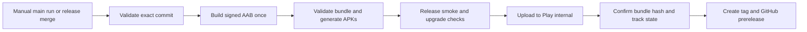
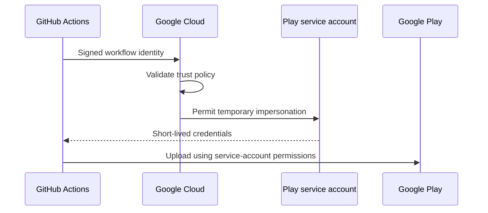

# Android continuous delivery plan

Status: proposed design. Implementation is not authorized by this document alone.

Prepared from the planning discussion and repository audit on 18 October 2026. Saved on 19 October 2026. Source findings below describe that audit and must be rechecked when implementation starts. No build, runtime test, Play upload, or credential setup was performed during planning.

## Goal and agreed decisions

Deliver one validated Android App Bundle to Google Play internal testing, then record the successful upload as an immutable tag and GitHub prerelease.

- Support manual execution from `main` initially.
- Support automatic delivery after PRs merge into a protected `release` branch once that branch exists.
- Create a GitHub prerelease with a tag and release notes for every successful internal upload.
- Attach no binaries to public GitHub releases.
- Store private credentials in GitHub environments. Create no repository-wide or organization-wide secrets.
- Extract repeated execution sequences into composite actions or reusable workflows.
- Put executable logic in scripts under `.github/scripts/`. YAML contains action calls and short script invocations, not embedded programs.
- Build once, test the candidate artifact, and publish that exact artifact.

Authentication and binary storage are recommendations awaiting a final choice. OIDC and confidential binary storage are separate decisions.

## Delivery flow



An internal-testing build intended for later promotion uses production configuration. The Play track controls who receives the app. It does not require a staging application configuration.

## Current foundations and gaps

These findings were observed in the audited revision `09bf687c78269637ea9319439b14da63a1383ee1`. They are configuration evidence, not release certification.

| Finding | Planned treatment |
| --- | --- |
| No GitHub Actions workflows exist. | Establish CI before enabling deployment. |
| A `release` environment exists and allows protected branches. | Reuse it for Play publishing and explicitly allow only intended delivery branches. |
| Branch rules require PR review but do not yet require CI statuses. | Add one stable aggregate required status once checks pass reliably. |
| Private upload-key signing already has a properties-file interface. | Reuse `DEVPULSE_SIGNING_PROPERTIES` or `devpulse.signingProperties`. |
| Android version code is fixed at `1`. | Add a centrally validated CI override. |
| BuildKonfig defaults to `staging`. | Explicitly select and verify production configuration. |
| App logging always selects debug logging, and HTTP logging uses `LogLevel.ALL`. | Configure release logging and verify that private feed content, URLs, and credentials do not appear in release logs. |
| `DPNotificationChannel.kt` imports an Android class in `commonMain`. | Resolve platform ownership before requiring broad KMP compilation. A compilation failure was inferred, not reproduced during the audit. |
| Room schemas 1, 2, and 3 and automatic migrations already exist. | Preserve them and keep meaningful JVM migration tests mandatory. |
| Most inspected device tests are templates. | Add a bounded release smoke suite. |
| Gradle build and configuration caching are already enabled. | Configure CI cache ownership and protect signing material. |
| No formatting integration, dependency locks, dependency verification metadata, or wrapper distribution checksum was found. | Introduce these controls with reviewed baselines. |

Relevant entry points:

- `androidApp/build.gradle.kts` owns release signing, R8, resource shrinking, ABI filters, and native symbol configuration.
- `buildSrc/src/main/kotlin/dev/shounakmulay/devpulse/buildsrc/constants/BuildConfig.kt` owns shared version configuration.
- `gradle/libs.versions.toml` owns dependency and build versions.
- `gradle.properties` enables caches and selects the default BuildKonfig flavor.
- `composeApp/src/commonMain/kotlin/dev/shounakmulay/devpulse/logging/DevPulseLogging.kt` configures app logging.
- `core/network/src/commonMain/kotlin/dev/shounakmulay/devpulse/core/network/DevPulseHttpClient.kt` configures HTTP logging.
- `core/notifications/src/commonMain/kotlin/dev/shounakmulay/devpulse/core/notifications/DPNotificationChannel.kt` contains the source-set issue.
- `core/data/db/src/jvmTest/kotlin/dev/shounakmulay/devpulse/core/data/db/FeedDiscoveryDatabaseTest.kt` contains existing migration, preservation, search, and reopen coverage.

Also inspect generated resources that write into tracked source directories. Choose either a verified committed snapshot or deterministic generation into build output. Avoid unexplained source mutation during CI.

## Branches and triggers

Use one delivery workflow for both release triggers so version allocation and publishing behavior have one owner.

| Event | Behavior |
| --- | --- |
| PR targeting `main` or `release` | Run CI without signing or Play credentials. |
| Push to `main` | Run CI. Publish only through manual execution. |
| Manual run from `main` | Validate, build, test, and publish the selected source commit. |
| PR merge into `release` | Run the same delivery pipeline automatically. |
| Feature branch or fork | CI only. |
| Tag creation | Record release identity. Do not trigger another build. |
| Scheduled execution | Run extended compatibility and reliability checks. |

Create `release` from a validated `main` commit when the branch is needed. Protect it before enabling automatic publishing. Prohibit direct pushes so a push event on that branch represents an approved merge. Return release hotfixes to `main` through PRs.

Start with one long-lived `release` branch. Introduce multiple `release/*` branches only when maintaining several supported versions requires them.

Validate the triggering ref as well as the checked-out SHA. Do not expose an arbitrary source-ref input that bypasses the allowed branch policy. Pin every job to the candidate SHA rather than resolving a moving branch again.

If a merge queue is introduced, add `merge_group` validation. Keep the aggregate required status present even when a job legitimately skips work. Avoid event-level path filters that leave a required check pending forever.

## Tags, versions, and prereleases

Use an internal tag such as:

```text
internal/v1.0.0-build.123
```

`1.0.0` is the Android version name. `123` is the Android version code.

After Play confirms the upload:

1. Create an annotated tag at the exact candidate source commit.
2. Create a GitHub prerelease and exclude it from the latest stable release.
3. Include release notes, source SHA, version code, AAB SHA-256, workflow link, validation results, and tester opt-in link.
4. Attach no binaries.

Protect `internal/*` tags against deletion and replacement. Failed uploads receive workflow evidence, not successful-release tags. If prerelease creation fails after a successful Play commit, retry only the recording step.

Generate release notes relative to the previous successful internal candidate for the relevant branch. Record the comparison base explicitly when `main` and `release` histories differ.

Reserve stable tags such as `v1.0.0` for future production promotion. Promote an already-tested AAB rather than rebuilding it.

Allocate CI version codes from a centrally configured offset plus the run number of the single delivery workflow. Seed the offset above existing Play uploads. Validate the range and candidate version before publishing. A workflow replacement or another publisher requires an explicit version-allocation migration.

Rerunning publication reuses the recorded candidate version and artifact. A different binary requires a new version code. Never use `run_attempt` to silently change a candidate's identity.

Add CI version inputs in the shared `BuildConfig` provider so Android metadata and runtime version information remain consistent. Validate values at the boundary and declare version and environment configuration as task inputs.

Reference: [Android versioning](https://developer.android.com/studio/publish/versioning).

## Reusable implementation structure

Proposed layout under `.github/`:

```text
workflows/
  ci.yml
  android-internal.yml
  _validate.yml
  extended-checks.yml

actions/
  setup-build/action.yml
  android-smoke/action.yml
  publish-play/action.yml
  collect-reports/action.yml

scripts/
  toolchain.py
  gradle.sh
  signing.py
  candidate.py
  smoke.py
  play_state.py
  github_release.py
```

| Location | Responsibility |
| --- | --- |
| Workflows | Triggers, dependencies, permissions, environments, and concurrency. |
| Composite actions | Repeated setup or execution sequences. |
| Scripts | Validation, filesystem operations, metadata, and recovery logic. |
| Gradle convention plugins | Kotlin checks, task dependencies, version providers, and build configuration. |

Extract genuinely repeated behavior. Avoid a wrapper for every individual command. Keep task lists and toolchain values in one authoritative location rather than repeating them across YAML, scripts, and Gradle.

Use a commit-pinned `r0adkll/upload-google-play` action inside the local publishing composite action. Its documentation supports JSON credentials and Workload Identity Federation. Explicitly fix the destination to `internal`; do not rely on the upstream default track. Add independent Play state verification and recovery around the upload action.

The publishing job must not invoke the application build or require the upload keystore. Validate the chosen action's credential handling, retry behavior, and dependency state before adopting its pinned revision.

Gradle Play Publisher is an alternative. It supports pre-existing artifacts and application-default credentials, but adds Gradle/AGP coupling and currently describes itself as being in maintenance mode. A custom uploader using Google's official libraries is a fallback only if the existing action cannot meet requirements. Its edit lifecycle and recovery behavior would need focused tests.

References:

- [Upload Google Play action](https://github.com/r0adkll/upload-google-play).
- [Gradle Play Publisher](https://github.com/Triple-T/gradle-play-publisher).

## Formatting and static analysis

Use ktlint through Spotless for Kotlin formatting. Explicitly target all KMP Kotlin source sets, Gradle Kotlin scripts, and `buildSrc`. Exclude generated output. Share `.editorconfig` between local development and CI.

Introduce `spotlessCheck` and `spotlessApply`. These are proposed tasks, not tasks verified to exist in the audited project. CI checks formatting and never rewrites source automatically. Put initial formatting changes in a focused change so behavior changes remain reviewable.

| Check | Recommendation |
| --- | --- |
| Kotlin formatting | Spotless with pinned ktlint and shared `.editorconfig`. |
| Android correctness | `:androidApp:lintRelease`, with deliberate coverage of Android KMP modules. |
| Workflow correctness | actionlint. |
| Workflow security | zizmor. |
| Shell scripts | ShellCheck. |
| Python scripts | Ruff. |
| Supply chain | Wrapper validation, distribution checksum, dependency locking, and dependency verification. |

Introduce Detekt after a compatibility trial against the actual Kotlin, Gradle, and AGP versions. Start with actionable rules and make it blocking after establishing a useful baseline. Avoid running duplicate formatting rules through Detekt.

Register a small set of aggregate Gradle verification tasks so local development and CI use the same definitions. Discover and run actual task names before making them required. One stable aggregate CI status must fail when a mandatory job fails or unexpectedly skips.

References:

- [Spotless Kotlin integration](https://github.com/diffplug/spotless/blob/main/plugin-gradle/README.md).
- [Detekt compatibility](https://detekt.dev/docs/introduction/compatibility/).
- [actionlint](https://github.com/rhysd/actionlint).
- [zizmor](https://docs.zizmor.sh/).

## Test coverage and release gates

Tests alone do not prove release correctness. Require unit/integration results, real release-artifact behavior, and measured pipeline performance.

| Frequency | Coverage |
| --- | --- |
| Every PR | Formatting, analysis, meaningful host/JVM tests, migration tests, and workflow checks. |
| Every internal candidate | Exact-AAB validation and one modern Android emulator smoke. |
| Persistence or schema changes | Supported baseline fixtures and a previous-release upgrade without clearing data. |
| Nightly and major releases | Minimum API, current API, ARM64, 16 KB pages, notification branches, and longer failure scenarios. |
| After Play processing | Tester installation/update through Play and available processing reports. |

Existing task candidates include `:core:data:db:jvmTest`, `:core:data:feed:jvmTest`, and meaningful common/domain/network/logging tests. The feed feature opts into Android host tests; verify `:feature:feed:testAndroidHostTest` during task discovery. Template package-name tests do not count as application smoke.

### Validate the final bundle

- Verify package name, version code/name, and selected runtime environment.
- Verify the AAB upload certificate against the expected fingerprint.
- Run bundletool validation.
- Verify packaged discovery data and its schema/format.
- Verify mapping and native-symbol availability.
- Inspect every shipped ABI and native library for page-size compatibility.
- Generate installable APKs from this exact AAB rather than independently assembling another release APK.

ABI declarations and legacy JNI packaging do not prove 16 KB compatibility. Validate both packaging and ELF alignment, with runtime coverage on a suitable device in the extended matrix.

### Exercise the release build

The mandatory candidate smoke covers fresh offline launch, discovery seed/search, deterministic RSS import, article opening, bookmark/settings persistence, cold restart, and background import/notification behavior. This tests R8 and resource shrinking through APKs generated from the actual candidate AAB.

Use a fixture server for required network scenarios. External feed availability belongs in a separate scheduled check.

### Prove data-preserving upgrades

Retain existing JVM migration/search/reopen tests. Add preservation of subscriptions, IDs, bookmarks, cached content, settings, queue records, foreign-key integrity, and FTS results. Exercise the upgraded application UI afterward.

Use the same test signer for baseline and candidate APKs in local upgrade tests. Seed through UI or appropriate instrumentation. A non-debuggable release cannot rely on `adb run-as` for fixture setup.

A Play-installed baseline uses the Play app-signing certificate, so locally test-signed or upload-key-signed APKs cannot replace it. Verify that upgrade path through Play separately.

Add production-database-builder coverage for creation callbacks and FTS cleanup after fresh installation and migration. The audit identified a coverage gap, not a confirmed FTS defect.

### Cover repository and background-work boundaries

Add targeted discovery refresh cases for first fetch, persisted ETag after restart, 304 without collection writes, changed/deleted collections, malformed catalogs, timeout, and transactional rollback.

Exercise immediate import after cold launch, notification permission allowed/denied, backgrounding, completion, failure/retry, and repeated import. A startup/channel race remains a hypothesis until reproduced.

Reference: [Android page-size validation](https://developer.android.com/guide/practices/page-sizes).

## Authentication and environments

### Prefer OIDC with the existing service account

GitHub issues signed proof identifying the repository, workflow, ref, and environment. Google Cloud validates that proof against a Workload Identity Federation policy and permits temporary service-account impersonation. The resulting credentials call Google Play using that service account's existing Play permissions.



The service-account email remains invited to Play Console. OIDC replaces a downloaded JSON private key. It does not require a personal Google login during each run and does not replace Android app signing.

| Choice | Advantages | Responsibility |
| --- | --- | --- |
| OIDC, recommended | No long-lived Google private key in GitHub; narrowly restricted workflow access. | Initial Google Cloud trust configuration. |
| Existing JSON key | Easier initial setup and possible reuse of existing credentials. | Environment-secret storage, rotation, and revocation of a long-lived credential. |

Authenticate immediately before the publishing operation. Use refreshable or appropriately scoped temporary credentials and verify behavior for long uploads. Do not acquire a short-lived token before a long build.

### Separate credential ownership

| Environment | Purpose | Contents |
| --- | --- | --- |
| `release-signing` | Build signed candidate | Upload keystore, passwords, alias, and expected certificate fingerprint. |
| Existing `release` | Publish to internal testing | OIDC provider/service-account variables, or a JSON key as an environment secret. |
| Future `production` | Promote approved candidate | Separate publishing permissions and stronger approval rules. |

Use environment variables for non-secret identifiers and environment secrets for private material. Create no global GitHub secrets. Keep secret-owning jobs directly in the delivery workflow unless a concrete reuse requirement warrants forwarding secrets through reusable workflows.

Security controls:

- Explicitly allow `main` and the future `release` branch.
- Bind OIDC trust to immutable repository identity, intended workflow, environment, and permitted refs. An environment-based subject alone does not prove a `main` execution.
- Limit the Play identity to this app and testing releases. Do not grant project Owner, financial-data, or production-release permissions for convenience.
- Grant `id-token: write` only where authentication or attestation needs it.
- Grant `contents: write` only to the job creating the tag/prerelease.
- Give PR jobs no deployment credentials and use read-only repository permissions.
- Avoid privileged `pull_request_target` execution of PR code and unverified artifacts from untrusted workflow runs.
- Reconstruct signing files under the runner temporary directory with restrictive permissions and cleanup on failure.
- Never print credentials, upload private signing files, or cache them.
- Pin external actions to full commit SHAs and update through reviewed PRs.

References:

- [Google Play API authentication](https://developers.google.com/android-publisher/getting_started).
- [GitHub OIDC with Google Cloud](https://docs.github.com/en/actions/how-tos/secure-your-work/security-harden-deployments/oidc-in-google-cloud-platform).
- [Workload identity trust conditions](https://docs.cloud.google.com/iam/docs/workload-identity-federation-with-deployment-pipelines).
- [GitHub environments](https://docs.github.com/en/actions/how-tos/deploy/configure-and-manage-deployments/manage-environments).

## Build performance and caching

Use Linux runners for Android. Pin the runner OS, JDK distribution/version, SDK packages, and bundletool. Record the actual runner image and tools in candidate metadata. Hosted image contents can change even when the OS label is fixed.

The audited project uses AGP 9.1.1, Kotlin 2.4.10, Gradle 9.3.1, compile/target SDK 37, and JVM bytecode target 11. AGP 9.1.1 requires JDK 17. Bytecode target 11 does not mean Gradle should run on JDK 11. Read tool versions from their authoritative configuration instead of duplicating values in workflow files.

### Cache defaults

- Use `gradle/actions/setup-gradle` as the sole Gradle User Home cache owner.
- Do not combine it with another Gradle cache or `setup-java` Gradle caching.
- Allow cache writes from trusted, credential-free `main` jobs.
- Make PR and signing jobs read-only cache consumers.
- Retain configuration caching for compatible credential-free checks.
- Disable configuration caching in signing jobs initially because signing properties load during configuration.
- Add encrypted configuration-cache persistence only if it earns its complexity, with an environment-scoped encryption key.
- Cache Kotlin/Native tooling separately with OS, architecture, and toolchain boundaries.
- Store candidates as immutable artifacts, not cache entries.
- Audit custom tasks for complete source, version, environment, and tool inputs before trusting cached outputs.

Select the Gradle action's cache provider explicitly after checking its current licensing and privacy behavior. Start with the basic provider if avoiding a proprietary cache provider is preferred.

### Minimize unnecessary work

Run cheap checks first. Parallelize lint and host tests within measured memory limits. Build the signed AAB after those gates. Generate smoke APKs from it. Avoid broad `build` or `allTests` invocations that execute unrelated targets or placeholder tests.

Measure before raising workers or heaps. The audited settings allocate 4 GB to Gradle and 3 GB to the Kotlin daemon and may overcommit smaller runners.

Keep macOS KMP compilation separate for relevant shared/iOS changes and scheduled coverage. Do not report Android-only checks as full KMP verification. A source-set defect must be fixed rather than permanently hidden by skipping another platform.

Record cold/warm duration, cache restore/save time, task reuse, emulator startup, upload time, and runner usage. Compare performance changes using the same candidate and check set. Establish a baseline before promising a time budget. Run the same checks periodically without caches to detect cache-dependent behavior.

Adopt paid runners or remote build-cache infrastructure only when measurements show a worthwhile benefit. Review transitive dependency locks and verification metadata rather than blindly trusting generated checksums.

References:

- [AGP compatibility](https://developer.android.com/build/releases/agp-9-1-0-release-notes).
- [Gradle Actions caching](https://github.com/gradle/actions/blob/main/docs/setup-gradle.md).
- [Dependency locking](https://docs.gradle.org/current/userguide/dependency_locking.html).
- [Dependency verification](https://docs.gradle.org/current/userguide/dependency_verification.html).

## Candidate identity, publication, and recovery

Record a candidate manifest with source SHA, run ID, artifact ID, version, runtime configuration, toolchain, signer fingerprint, AAB digest, and validation results. Retrieve artifacts by immutable identity. Verify the manifest and digest before publication. A checksum alone does not establish trusted provenance.

| Situation | Behavior |
| --- | --- |
| A gate fails | Stop before publication and retain diagnostic reports. |
| Artifact is downloaded | Verify immutable identity, digest, source binding, and provenance. |
| Upload times out | Reconcile Play state before retrying. |
| Version exists with the same digest | Resume candidate verification or track assignment. |
| Version exists with a different digest | Fail without substituting another binary. |
| Play commit succeeds but GitHub recording fails | Retry tag/prerelease creation without another upload. |
| Initial Play setup or draft status blocks delivery | Report the unmet prerequisite rather than silently treating a draft as tester availability. |
| A newer candidate overtakes an older one | Reject stale publication after checking current Play state. |

Serialize publication per application, not just per triggering branch. Do not cancel an active publishing transaction. CI may cancel superseded PR runs. Choose queue behavior explicitly and recheck version ordering because concurrency alone does not guarantee it.

Reconcile uncertain completion after upload or commit. Handle expired edits, credential expiry, transient failures, and concurrent Console changes. Do not blindly retry an entire publishing workflow.

After commit, confirm the AAB SHA-256 and intended version on the internal track through authenticated reads. Bound polling and report processing delays accurately. Distinguish uploaded, assigned to internal testing, and available to testers.

Confirm initial Play registration and first accepted AAB before commissioning API delivery. Configure release status explicitly. Internal testing and Internal App Sharing are different destinations; do not mistake an Internal App Sharing download URL for the tester opt-in link.

Recover from a bad installed release with a forward fix and higher version code. Reassigning an older artifact does not downgrade apps already installed on tester devices.

References:

- [Play bundle digest resource](https://developers.google.com/android-publisher/api-ref/rest/v3/edits.bundles).
- [Play edits](https://developers.google.com/android-publisher/edits).
- [GitHub concurrency](https://docs.github.com/en/actions/how-tos/write-workflows/choose-when-workflows-run/control-workflow-concurrency).
- [Internal testing setup](https://support.google.com/googleplay/android-developer/answer/9845334).

## Evidence retention and binary visibility

GitHub prereleases contain tags, notes, hashes, and evidence links, with no binaries attached.

Actions artifacts from a public repository are downloadable by signed-in repository readers. Environment protection does not make those artifacts confidential.

Choose one storage policy:

- Use short-lived Actions artifacts if public-repository reader access to candidate binaries is acceptable.
- Use a private artifact bucket with OIDC, separate read/write permissions, immutable object identity, and retention rules if binaries must be confidential.

Retain candidate metadata, test/lint reports, sanitized failure logs, R8 mappings, native symbols, and build timings for an explicit period. Keep signing material and generated authentication files out of every artifact. Use deterministic fixtures so diagnostics do not contain real private feed content.

Reference: [Workflow artifact access](https://docs.github.com/en/actions/how-tos/manage-workflow-runs/download-workflow-artifacts).

## Implementation stages and acceptance evidence

Execution starts only after approval of implementation scope. Deliver sequential changes that each end in a verifiable state.

| Stage | Scope | Required evidence |
| --- | --- | --- |
| 1. Release correctness | Logging, explicit runtime configuration, central version overrides, source-set fixes, and toolchain checks. | Targeted tests and release configuration inspection. |
| 2. CI | Formatting, lint, meaningful tests, dependency controls, reusable setup, and branch statuses. | Passing PR run plus intentional failing-check cases. |
| 3. Candidate creation | Environment signing, immutable metadata, bundle validation, release smoke, and cache policy. | Successful build-only run, upgrade evidence, and cold/warm timing records. |
| 4. Publishing and recording | OIDC or environment key, uploader integration, reconciliation, tags, and prerelease notes. | Confirmed internal upload and recovery tests. |
| 5. Release branch | Branch protection, allowed environment refs, and merge trigger. | A merged PR follows the same proven pipeline. |

Commissioning checklist:

- [ ] A failed lint or test gate prevents signing/publishing.
- [ ] An unauthorized branch cannot access signing or Play credentials.
- [ ] Missing credentials fail with a clear, non-secret error.
- [ ] An altered artifact or mismatched manifest is rejected.
- [ ] A release AAB passes signer, manifest, native, and packaged-resource checks.
- [ ] APKs derived from the exact candidate pass fresh-install and persistence smoke.
- [ ] An upgrade preserves fixture data and works through the UI.
- [ ] Duplicate publication reconciles the same digest without a second upload.
- [ ] Credential expiry and uncertain API completion produce safe, bounded recovery.
- [ ] Failed GitHub recording can resume after a successful Play commit.
- [ ] Play read-back confirms the version/digest and the expected internal track.
- [ ] A tester can install or update through Play.
- [ ] The tag points to the candidate commit and the prerelease has notes but no binaries.
- [ ] Cached and uncached runs execute equivalent gates and produce valid candidates.
- [ ] Manual `main` delivery and protected `release` merges use the same pipeline.

Use focused tests for release-state and recovery logic. Validate the real GitHub and Play behavior during commissioning. Compilation alone is not publication proof.

## Recommended extras and deferred work

Include artifact provenance, dependency-update PRs, dependency inventory, size reporting, and retained mapping/native symbols in the initial setup. Attest the signed AAB and verify its provenance before publishing. Protect workflow and build-configuration changes through review.

Defer paid device farms, remote build-cache infrastructure, arbitrary coverage-percentage gates, and production automation until baseline measurements justify them. Introduce crash/reliability monitoring as an explicit product decision rather than silently adding another external service.

The main counterargument to a comprehensive pipeline is maintenance cost. Keep the mandatory smoke bounded and deterministic. Put broad compatibility and unreliable external integrations in scheduled checks, with a clear policy for findings that must block the next release.

Reference: [GitHub artifact attestations](https://docs.github.com/en/actions/how-tos/secure-your-work/use-artifact-attestations/use-artifact-attestations).

## Inputs needed during implementation

- [ ] Choose OIDC or the existing JSON key. OIDC is recommended.
- [ ] Identify the existing service-account email and Cloud project ID. Read only those metadata fields locally if using an existing JSON file. Do not paste private keys into chat.
- [ ] Verify Play permissions, initial app registration, first accepted AAB, and tester configuration.
- [ ] Identify the existing upload keystore through a secure local path and verify its certificate against Play. Do not regenerate the key merely for CI.
- [ ] Choose short-lived Actions artifacts or confidential bucket storage for binaries.
- [ ] Choose evidence and binary retention periods.
- [ ] Grant appropriate repository administration access for environment and ruleset configuration when that stage begins.

The user-approved choices already settled are manual delivery from `main`, eventual automatic delivery from a protected `release` branch, and GitHub prereleases with tags and notes but no binary assets.

## Planning principles

Pstack's Sequence work into verifiable units shaped the staged rollout. Prove It Works shaped exact-artifact smoke and Play read-back checks. Guard the Context Window shaped separate build and release audits. These principles do not replace repository checks or user approval of implementation.
